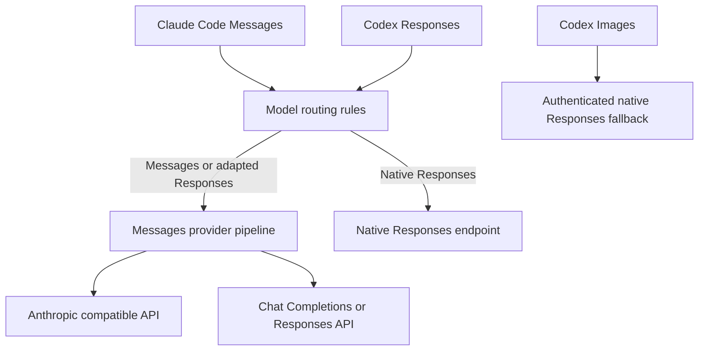

# Open Harness Router kickoff

Open Harness Router lets Claude Code and Codex use configured model providers
through one local Python 3.13 service. `routing.yaml` selects the provider by
model name; the first matching rule wins. Credentials stay with the router,
except explicitly forwarded native client authentication.

## Request flow



- Messages requests use passthrough or the existing OpenAI translation pipeline.
- Codex uses native Responses when `responses_base_url` is configured.
  An `openai-translate` provider with `api_flavor: responses` also serves native
  Responses using its `base_url`; that setting is invalid for `passthrough`.
  Other own-key providers use Responses ↔ Messages mappers and the same pipeline.
- `default` controls the Messages fallback; `responses_default` independently
  controls the Responses fallback. Explicit model rules take precedence.
- Image generation and edits use only the explicitly authenticated native
  `responses_default`, independently of the selected assistant model.

## Configure and run

Run from the repository root. Keep existing local files when updating:

```bash
uv sync
test -e .env || cp .env.example .env
test -e routing.yaml || cp routing.example.yaml routing.yaml
PYTHONPATH=src uv run python -m cli.validate_routing
make run
```

The example enables native Anthropic passthrough only. Own-key custom routes
need an endpoint, a key in `.env`, and a matching rule in `routing.yaml`.
Use `responses_base_url` only after verifying the upstream Responses endpoint;
otherwise own-key custom routes can use the adapter without that setting.
Configuration is read at startup, so changes require a validated restart.

| Address | Purpose |
| --- | --- |
| `http://127.0.0.1:8787/health` | Router health and configured providers |
| `http://127.0.0.1:8787/dashboard` | Requests, errors, usage and routing |
| `http://127.0.0.1:8787/codex/models` | Combined Codex catalog |
| `http://127.0.0.1:8787/v1/models` | The same catalog as OpenAI model IDs |

`make run-proxy` additionally starts the CONNECT/TLS proxy on port 8788 for
Claude Code. Codex uses port 8787 and needs no forward-proxy root certificate.
See [client setup](README.md#connecting-codex) and
[background services](README.md#running-in-the-background) for full setup.

## Choose models in Codex

Configure an own-key custom route first. To retain native account models too,
configure `responses_default` and `codex_catalog_path` as shown in the
[Codex guide](README.md#connecting-codex), using this machine's existing login.
Native-auth profiles keep `model_provider = "openai"` and use `openai_base_url`.

```bash
make sync-codex-config  # preview under state/codex
# Back up an existing dedicated profile/catalog before installing.
# Replace MODEL_ID with the desired configured model ID.
PYTHONPATH=src uv run python -m cli.sync_codex_config --output-dir ~/.codex --model MODEL_ID
codex -p open-harness-router
```

The generator writes the dedicated profile and catalog, leaving `config.toml`
alone. Preserve any personal profile overrides when regenerating. Restart
Codex and open `/model` after changing its catalog. `cdx` is an optional shell
alias for `codex -p open-harness-router`, not a command installed by the repo.

Switching models with `-m` retains the profile's reasoning effort. Ensure it
is supported by the upstream: Kimi may reject an inherited `none`. Explicit
profile settings override catalog defaults; select a supported effort with
`-c 'model_reasoning_effort="high"'` when required, or use separate profiles.

The picker includes configured exact model IDs and `client_models`, plus the
native account catalog when configured. It does not discover every upstream
model or guarantee access: credentials, quotas and permissions still apply.

Translated routes support text/images, streaming, function/freeform tools,
namespaces and tool-result continuation. They require full `input` history;
server-side response references, structured output and unsupported hosted tools
are rejected. Optional hosted web search is omitted with a warning and an
instruction that it is unavailable; forced hosted search is rejected. Native
Responses forwarding preserves its upstream protocol. A Codex login cannot
authenticate an Anthropic subscription-only Messages provider.

## Validate changes

Run `make full-check` for lint, type checking and offline tests. Use mocked
upstreams for regression tests. Live compatibility checks must cover text,
streaming, tool calls and continuation, and confirm the selected route from
router metadata. A model's self-reported identity is insufficient.

Use an isolated port and temporary state for development. Before restarting
a configured service, validate routing and wait for active requests to finish.
After a release, verify `/health` and that `/dashboard/state` reports the new
version with `restart_required: false`.

## Where to work

| Location | Responsibility |
| --- | --- |
| `src/api/` | HTTP endpoints and ASGI adaptation |
| `src/routing/` | Configuration, first-match routing and provider registry |
| `src/providers/` | Upstream clients; `responses_bridge.py` reuses Messages providers |
| `src/conversion/` | Protocol mappers, including `responses_ingress.py` and `responses_output.py` |
| `src/services/` | Monitoring, storage, retries and conversation state |
| `src/cli/` | Validation, client configuration and release helpers |
| `tests/` | Offline unit and integration coverage |

Provider code uses `ProviderResult` and `ClientChannel`, independently of
FastAPI. Release resources on success, error and disconnect, including streams
that never start. Own-key custom providers must never receive native Codex
credentials; client authentication is forwarded only through explicitly
configured native forwarding.

Read [AGENTS.md](AGENTS.md) before editing. [README.md](README.md) contains the
operational reference; [CHANGELOG.md](CHANGELOG.md) records releases. Follow
[the release workflow](.claude/skills/release/SKILL.md) for publication.
Machine-specific routing, `.env`, certificates, `state/` and local handoffs stay
gitignored; use public examples in shared documentation.
